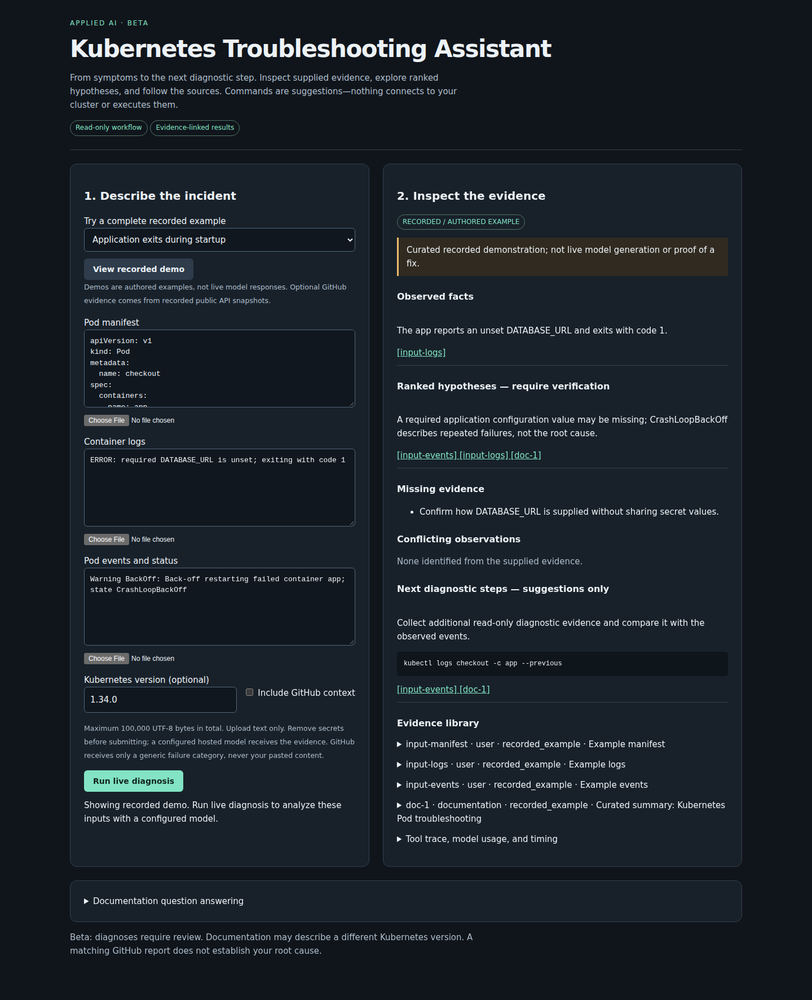
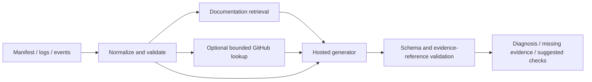

# Kubernetes Troubleshooting Assistant

An applied ML application for Kubernetes teams investigating incidents, with a usable triage beta and a separate function-calling fine-tuning experiment.

Paste or upload Pod manifests, logs, and events to inspect observed facts, ranked hypotheses, missing evidence, and suggested diagnostic checks. Answers reference supplied evidence and pinned Kubernetes documentation; optional read-only GitHub issue/release context is clearly distinguished. Commands are suggestions, never executed.



[Watch the short walkthrough](docs/media/troubleshooting-demo.webm) · [Mobile screenshot](docs/media/troubleshooting-mobile.png) · [Application/API guide](projects/01-rag-k8s-docs/README.md) · [Current status](docs/STATUS.md) · [Interface design and validation](docs/UI_POLISH.md)

**Release status:** local beta. Three explicitly labeled curated demos work without model credentials. The UI has been exercised in a real browser. Real-provider incident validation, human-reviewed quality results, full Docker verification, and public hosting remain pending. No public deployment URL is claimed.

The next milestone is a verified live release followed by a [manual-versus-assisted investigation pilot](docs/CLIENT_PILOT.md). Time savings and client outcomes have not yet been measured. See the [Applied ML delivery route](docs/APPLIED_ML_ROADMAP.md).

## Run the application

Use Python 3.12 and uv 0.13.6 on Linux/WSL. From the repository root:

```bash
cd projects/01-rag-k8s-docs
uv sync --frozen
# Live mode requires a built index and a server-side GROQ_API_KEY or GEMINI_API_KEY.
# Demos remain accessible if live initialization is unavailable.
RAG_INDEX_DIR=data/index-beta-final uv run uvicorn rag.api:app --app-dir src --host 127.0.0.1 --port 8000
```

Open [the local application](http://127.0.0.1:8000) and select a recorded example, or follow the [index and provider setup](projects/01-rag-k8s-docs/README.md#runtime-setup-models-and-index) for live diagnosis. The Docker image targets free CPU hosting and explicitly selects CPU PyTorch. The fine-tuning CUDA environment remains separate.



## Evidence and engineering tradeoffs

- The beta preserves the existing `/ask` API and adds structured `/diagnose`, demo endpoints, upload limits, version warnings, provider failure handling, bounded tool traces, and cached public API evidence.
- The incident evaluation compares direct prompting, RAG, and RAG with recorded GitHub responses. Twenty draft incidents are split 10 development / 10 held-out; semantic quality requires hash-bound human reviews. Unreviewed scores are left null.
- Historical retrieval results predate chunking/duplicate/context fixes and remain labeled historical. Refreshed retrieval measurements and encoder truncation diagnostics belong to separate artifacts; they do not establish incident diagnosis quality.
- The [fine-tuning project](projects/02-finetune-function-calling/README.md) includes a [standalone Colab notebook](projects/02-finetune-function-calling/training/colab.ipynb). Its base/adapter/hosted domain comparison is experimental and has not been used to justify production routing.
- Representative limitations: logs may refer to different workloads or times; GitHub reports do not establish cause; long code blocks can exceed the encoder; an unavailable model yields an explicit error, never a disguised recorded answer. See the [evaluation/release guide](projects/01-rag-k8s-docs/README.md#incident-and-domain-evaluation).

## Refreshed retrieval evidence

Thirty development questions (25 answerable) on the rebuilt 12,084-chunk corpus:

| Mode | Recall@5 | Recall@10 | MRR@10 | nDCG@10 | p95 retrieval ms |
|---|---:|---:|---:|---:|---:|
| dense | 0.840 | 0.920 | 0.732 | 0.761 | 68 |
| hybrid | 0.820 | 0.940 | 0.791 | 0.803 | 164 |
| hybrid_rerank | 0.900 | 0.940 | 0.801 | 0.829 | 23,154 |

These measurements cover retrieval only. Hybrid is the free-CPU serving default; reranking remains opt-in because of its latency. Thirty-four oversized chunks still truncate and are reported. Local timings reflect shared development load. See the [artifacts, provenance, and limitations](projects/01-rag-k8s-docs/README.md#refreshed-retrieval-measurements). Incident diagnosis correctness remains unmeasured until real-provider runs and human review.

## Contributor checks

The root environment contains only locked CPU check dependencies. No models, prepared datasets, GPU, or API keys are needed:

```bash
uv sync --frozen
uv run --frozen python scripts/dev.py check
uv run --frozen python scripts/dev.py check --project rag
uv run --frozen python scripts/dev.py check --project finetune
# Both commands also support test/lint instead of check.
```

Both CI workflows use these project-specific commands. Independent checks continue after failures and return a nonzero exit status. Current tests cover fake-provider incident integration, GitHub budgets/cache/failures, evidence/grounding validation, human-review integrity, and the independent training pipeline.

For NVIDIA training use the [isolated GPU environment](environments/gpu/README.md). It has its own lockfile and virtual environment and is never installed by CPU CI.

Dated plans, audits, ledgers, and the [debugging report](docs/debugging/2026-11-04-debugging-report.md) remain preserved historical records. [Current status](docs/STATUS.md) owns verified capabilities and pending release work.
