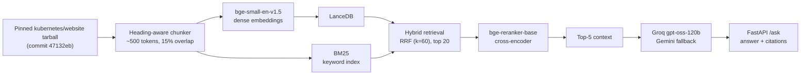

# Kubernetes Docs RAG

Citation-backed retrieval-augmented question answering over the pinned Kubernetes documentation, with a small, inspectable evaluation harness instead of a framework.

**Status (dev split):** retrieval evaluation and the offline extractive baseline are complete on 30 dev questions for the 500- and 800-token indexes. Generation/judge evaluation, deployment, and the 300-token index are still gated (see [Gates](#gates)). No test-split numbers are published: the 60-question gold set is not certified yet.

## Architecture



The corpus is pinned to `kubernetes/website` commit `47132eb5367cfdcba0a3b33a0b3ffc81185bd7e8` (`release-1.34`); nothing is scraped at runtime.

## Retrieval results (dev, n=30)

Index: **11,744 chunks from 1,460 documents** (500 tokens, 15% overlap), built in 1,958 s on CPU.
Generated from the committed JSON with:

```bash
uv run python -m evals.summarize \
  evals/results/dev-dense.json \
  evals/results/dev-hybrid.json \
  evals/results/dev-hybrid-rerank.json
```

| config | n | R@5 | R@10 | R@20 | MRR@10 | nDCG@10 | p95 ms |
|---|---:|---:|---:|---:|---:|---:|---:|
| dense | 30 | 0.860 | 0.920 | 0.920 | 0.738 | 0.766 | 49 |
| hybrid (RRF) | 30 | 0.760 | 0.940 | 0.940 | 0.756 | 0.788 | 128 |
| hybrid + rerank | 30 | 0.900 | 0.940 | 0.940 | 0.795 | 0.824 | 15,063 |

Findings:

- Hybrid retrieval improves recall@10 and nDCG over dense, but loses recall@5 — RRF lets BM25-only documents displace dense hits at the top.
- The cross-encoder recovers recall@5 and improves MRR/nDCG, at ~15 s per query on this CPU. That latency is the main deployment risk; the API defaults to 5 context chunks.
- The 15-question smoke run (`smoke-hybrid`, `smoke-hybrid-rerank`) passes the configured thresholds (recall@10 ≥ 0.50, nDCG@10 ≥ 0.35), but n=15 is noisy and is not used for the headline comparison.
- At 800 tokens the reranker improves MRR/nDCG further (0.819/0.843 vs 0.795/0.824 at 500), while recall@5 is slightly lower (0.880 vs 0.900); with n=30 these are directional, not significance-tested.

## Chunk-size ablation

The 500-token rows above are the headline. The 800-token index has 10,014 chunks and took 1,778 s to build; the 300-token build is deferred (concurrent builds throttled to ~44 s/batch on this CPU, versus ~13–20 s alone). `scripts/run_ablations.sh` rebuilds all three sizes and writes `evals/results/ablation-<size>-<mode>.json`.

| chunk | mode | n | R@5 | R@10 | R@20 | MRR@10 | nDCG@10 | p95 ms |
|---:|---|---:|---:|---:|---:|---:|---:|---:|
| 500 | dense | 30 | 0.860 | 0.920 | 0.920 | 0.738 | 0.766 | 49 |
| 500 | hybrid | 30 | 0.760 | 0.940 | 0.940 | 0.756 | 0.788 | 128 |
| 500 | hybrid + rerank | 30 | 0.900 | 0.940 | 0.940 | 0.795 | 0.824 | 15,063 |
| 800 | dense | 30 | 0.860 | 0.920 | 0.920 | 0.769 | 0.786 | 59 |
| 800 | hybrid | 30 | 0.760 | 0.900 | 0.940 | 0.769 | 0.783 | 125 |
| 800 | hybrid + rerank | 30 | 0.880 | 0.940 | 0.940 | 0.819 | 0.843 | 15,128 |

The 500 rows come from `evals/results/dev-*.json`; the 800 rows from `evals/results/ablation-800-*.json`. The 300-token row is absent rather than estimated.

## Offline extractive baseline

`RAG_OFFLINE=1` answers by selecting the best-overlapping retrieved chunk and citing it. It exists so tests and CI run without API keys; it is **not** the LLM generation result.

Committed: `evals/results/dev-offline-extractive.json` (hybrid retrieval, no rerank).

| config | n | cit-P | cit-R | fact-cov | refusal | p95 ms |
|---|---:|---:|---:|---:|---:|---:|
| offline extractive | 30 | 0.600 | 0.500 | 0.190 | 0.000 | 225 |

The extractive answerer always answers (refusal 0.000) and covers only 19% of required facts; 40% of its citations miss the gold page. That gap is the reason for the LLM generation path — it is not a quality result for the project.

Produced with:

```bash
uv run python evals/run_eval.py --split dev --offline --mode hybrid \
  --index-dir data/index --output evals/results/dev-offline-extractive.json
```

## Generation and judge (not yet run)

Generation requires a free-tier API key and the gold set must be signed before any test-split run:

```bash
export GROQ_API_KEY=...          # primary: openai/gpt-oss-120b
export GEMINI_API_KEY=...        # fallback and cross-family judge
uv run python evals/run_eval.py --split dev --judge --index-dir data/index \
  --output evals/results/dev-generation.json
uv run python evals/calibrate_judge.py --results evals/results/dev-generation.json
```

`calibrate_judge.py` exits non-zero until κ ≥ 0.75 on at least 20 human-labelled pairs in `evals/calibration.jsonl`. The test split is refused while `evals/CERTIFICATION.md` is unsigned (`--require-certified`).

## Quickstart

```bash
uv sync
uv run python scripts/build_index.py          # downloads the pinned corpus; ~33 min CPU
RAG_OFFLINE=1 RAG_INDEX_DIR=data/index \
  uv run uvicorn rag.api:app --app-dir src --port 8000
uv run pytest -q
```

Open `http://localhost:8000` for the minimal UI, or `POST /ask` with `{"question": "..."}`. `GET /health` reports the index state. No API key is needed for tests or offline mode.

Run the retrieval eval:

```bash
uv run python evals/run_eval.py --split dev --retrieval-only --mode hybrid_rerank \
  --index-dir data/index --output evals/results/dev-hybrid-rerank.json
uv run python -m evals.summarize evals/results/*.json
```

## Design decisions

- **Hybrid before rewrites:** dense+BM25 with RRF improves recall at depth; LLM query rewriting is deferred because it adds a free-tier API call and latency for a noisy gain.
- **Rerank last:** the cross-encoder is the largest quality lever but the largest latency cost, so it is a separate, measurable stage.
- **Pinned docs, local embeddings:** the corpus and both encoders are free and reproducible; no vector-DB server and no LangChain.
- **Custom eval harness:** a small harness over a certified domain set is easier to audit and to discuss than a framework dashboard.
- **Provider fallback, fail loudly:** a retired or unknown model ID raises instead of silently returning empty answers; `/ask` returns 503 when every provider fails.

## Gates

- **Generation/judge:** set `GROQ_API_KEY` and `GEMINI_API_KEY`; run the dev commands above. No online generation number has been produced yet.
- **Test split:** sign `evals/CERTIFICATION.md` (Reviewer/Date/Notes). `run_eval.py` refuses the test split while it is unsigned; `validate_questions.py --require-certified` fails closed.
- **Deployment:** requires Docker and a Hugging Face write token. `scripts/deploy_space.sh` is provided but unexecuted; Docker is not installed on the development machine.
- **300-token ablation:** the CPU cost is the reason it is not in the table yet; `scripts/run_ablations.sh` rebuilds all chunk sizes and writes `evals/results/ablation-*.json`.

## Limitations

- CPU-only development: reranking costs ~15 s/query; a deployed demo will be slow on free CPU.
- Results are dev-split and retrieval-only; neither generation quality nor judge–human κ has been measured yet.
- The Docker image is untested locally (Docker is not installed); it rebuilds the index at image-build time (~33 min) and carries both encoders.
- Free-tier cost fields are `$0` with token counts; no paid-tier price table is used.
- The offline extractive answerer always answers, so refusal accuracy is expected to be poor in that mode.

## Attribution

See [ATTRIBUTIONS.md](ATTRIBUTIONS.md). Kubernetes documentation is CC-BY-4.0; no code was copied from unlicensed repositories.
