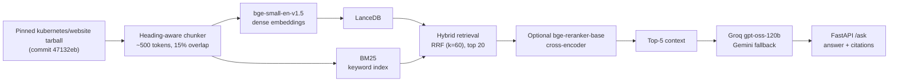

# Kubernetes Troubleshooting Assistant

A beta incident-triage application over pinned Kubernetes documentation. Supply Pod manifests, logs, and events; inspect observations, ranked hypotheses, missing evidence, conflicts, diagnostic suggestions, and source provenance. The original documentation Q&A endpoint remains available.

See [current status and next milestones](../../docs/STATUS.md#kubernetes-troubleshooting-assistant) for verified capabilities and remaining work. Online-generation evaluation and full Docker deployment are still unverified; the gold set is not human-certified.

**Historical results:** the benchmark tables below predate fixes to chunking, duplicate handling, and generation context size. Rebuild indexes and rerun dev evaluations before treating them as current results. The [debugging report](../../docs/debugging/2026-11-04-debugging-report.md) preserves the earlier findings.

## Incident workflow

The main UI accepts pasted evidence and UTF-8 text uploads. The combined manifest/logs/events limit is **100,000 bytes**. An optional Kubernetes version is checked against indexed documentation metadata. GitHub context is disabled by default. Commands are displayed as text; the app does not connect to clusters or execute commands.

Three curated recorded examples cover CrashLoopBackOff, ImagePullBackOff, and unschedulable Pending Pods. They remain available without an index or model key and are visibly labeled as authored/recorded examples. Clicking **Run live diagnosis** makes a separate request and returns an explicit availability error if the live backend cannot run; it never silently substitutes a demo.

- `POST /diagnose`: `manifest`, `logs`, `events`, optional `kubernetes_version`, and `github_lookup` (default false). Returns validated diagnosis content, evidence, warnings, tool trace, actual provider/model usage, timing, and `mode`.
- `GET /demos`: three example inputs; `GET /demos/{id}?github_lookup=true` adds recorded GitHub evidence.
- `POST /ask`: preserved documentation question answering.
- `GET /health`: reports initialization/index state; demos remain available in degraded mode.

Live generation uses one documentation retrieval, at most two GitHub GET requests, and one model-generation operation with configured provider fallback. Provider requests have bounded timeouts and no SDK retries. Generated observations must reference supplied evidence; all references must exist, and a GitHub-only hypothesis is rejected. Schema/reference validation does not prove factual correctness; human evaluation remains required.

GitHub search is restricted to `kubernetes/kubernetes`; only a fixed generic failure category is transmitted, never raw manifests/logs. Release lookup targets the requested exact version, or latest release context when no version is supplied. A minor-only version may have no matching release and is reported unavailable. Responses are cached in a bounded in-memory cache and respect rate-limit/retry headers. Failures degrade to local evidence and documentation. Issue reports are community context, never proof of cause. `GITHUB_TOKEN` is optional and server-side. Endpoint behavior follows [GitHub search](https://docs.github.com/en/rest/search/search) and [release API documentation](https://docs.github.com/en/rest/releases/releases).

CPU serving defaults to hybrid retrieval. Set `RAG_RETRIEVAL_MODE=hybrid_rerank` to explicitly enable the cross-encoder, or `dense` for the dense-only ablation. The historical reranker has a high CPU latency cost; a real refreshed-index `/ask` verification took 26,940 ms with 26,805 ms in reranking under local shared load. The default hybrid development run measured 164 ms p95 retrieval, not an online-generation SLA. `/health` separately reports live-diagnosis and recorded-demo readiness.

## Incident and domain evaluation

`evals/incidents.jsonl` contains 20 authored synthetic drafts: 10 development / 10 held-out. Gold observations, acceptable hypotheses, source URLs, missing evidence, and next checks are supplied. Held-out runs are refused until `evals/INCIDENT_CERTIFICATION.md` is signed. These cases are separate from the existing 60-question documentation benchmark. No incident quality result has been human-certified yet.

From this project directory with full runtime dependencies and a fresh index:

```bash
# Compare direct prompting, RAG, and RAG plus recorded public GitHub responses.
uv run python evals/incident_eval.py --mode all --split dev \
  --index-dir data/index-beta-final --output evals/results/incidents-dev-live.json

# Integration exercise only: fake provider outputs are not quality measurements.
uv run python evals/incident_eval.py --fake-provider --split dev \
  --index-dir data/index-beta-final --output evals/results/incidents-dev-integration.json

# Fill the emitted .reviews.jsonl manually; summarize the SAME saved predictions.
uv run python evals/incident_eval.py \
  --summarize-existing evals/results/incidents-dev-live.json \
  --reviews evals/results/incidents-dev-live.reviews.jsonl \
  --output evals/results/incidents-dev-reviewed.json
```

Human review records diagnosis correctness, unsupported-claim counts, citation support, and appropriate requests for missing evidence. Labels are bound to prediction hashes. Unreviewed semantic metrics remain null; schema validity and fake-provider results are never labeled diagnosis accuracy. Latency/token measurements preserve actual provider metadata and per-case outputs. Baseline/RAG/GitHub arms use identical development inputs; GitHub uses recorded snapshots, not changing live search results.

`evals/tool_selection.jsonl` is a separate small domain-only benchmark, not training data and not derived from held-out incidents. Use the experimental base/adapter/hosted comparison command in the [fine-tuning README](../02-finetune-function-calling/README.md#domain-tool-selection-benchmark). The deployed assistant uses the hosted generator; no adapter is promoted without a domain comparison.

## Release verification and walkthrough

The [recorded walkthrough](../../docs/media/troubleshooting-demo.webm) and [desktop screenshot](../../docs/media/troubleshooting-demo.png) show the real UI with clearly labeled authored demos. They do not demonstrate online model quality.

```bash
# Run against a locally running server; verifies health and all demo endpoints.
uv run python scripts/release_check.py --base-url http://127.0.0.1:8000 \
  --output evals/results/release-local.json

# Once server-side provider keys are configured, also exercise all three live incidents.
uv run python scripts/release_check.py --base-url http://127.0.0.1:8000 --live \
  --output evals/results/release-live.json
```

Local browser checks cover desktop/mobile layout, text uploads, invalid UTF-8 and oversize rejection, fake-provider live rendering, unavailable-provider recovery, and JavaScript errors. The wheel builds and deployment staging includes packaged resources. **Full Docker build/run, real-provider incident validation, and public hosting remain pending:** Docker and provider/Hugging Face credentials are unavailable in the current development environment. There is no published public demo URL yet.

## Contributor checks (CPU only)

From the repository root, use the shared environment; no models, datasets, or API keys are needed:

```bash
uv sync --frozen
uv run --frozen python scripts/dev.py check --project rag
```

## Runtime setup (models and index)

Full runtime setup downloads model libraries and weights and builds the corpus index. From the repository root:

```bash
cd projects/01-rag-k8s-docs
uv sync --frozen
uv run python scripts/build_index.py --index-dir data/index-beta-final  # downloads pinned corpus/models; CPU time varies
RAG_OFFLINE=1 RAG_INDEX_DIR=data/index-beta-final \
  uv run uvicorn rag.api:app --app-dir src --port 8000
```

Open `http://localhost:8000` for the minimal UI, or `POST /ask` with `{"question": "..."}`. `GET /health` reports the index state. No API key is needed for tests or offline mode.

Run the remaining examples from this project directory. For retrieval evaluation:

```bash
uv run python evals/run_eval.py --split dev --retrieval-only --mode hybrid_rerank \
  --index-dir data/index --output evals/results/dev-hybrid-rerank.json
uv run python -m evals.summarize evals/results/*.json
```

## Architecture



The corpus is pinned to `kubernetes/website` commit `47132eb5367cfdcba0a3b33a0b3ffc81185bd7e8` (`release-1.34`); nothing is scraped at runtime.

## Refreshed retrieval measurements

The final chunker-source index contains **12,084 chunks from 1,460 files**, with a 500-token target and a 512-token encoder limit. **34 oversized chunks still truncate** and are reported explicitly. The exact chunker source hash and opt-in reuse provenance are stored in [index diagnostics](evals/results/beta-index-metadata.json). Historical indexes and artifacts remain untouched.

Measured on 30 development questions; retrieval quality aggregates over the 25 answerable questions. These are retrieval measurements, not incident diagnosis or generated-answer quality. Local CPU latency was observed under shared development load, not a controlled throughput benchmark.

| Mode | Recall@5 | Recall@10 | MRR@10 | nDCG@10 | p95 retrieval ms |
|---|---:|---:|---:|---:|---:|
| dense | 0.840 | 0.920 | 0.732 | 0.761 | 68 |
| hybrid | 0.820 | 0.940 | 0.791 | 0.803 | 164 |
| hybrid_rerank | 0.900 | 0.940 | 0.801 | 0.829 | 23,154 |

Hybrid is the CPU serving default: it improves recall at depth while avoiding cross-encoder latency. Reranking improves top-five retrieval in this sample but costs roughly 23 seconds at p95. With only 25 answerable dev questions, differences are directional and not significance-tested.

Source artifacts: [dense](evals/results/beta-dev-dense.json), [hybrid](evals/results/beta-dev-hybrid.json), and [reranked](evals/results/beta-dev-hybrid_rerank.json). Reproduce with `evals/run_eval.py --split dev --retrieval-only --mode <mode> --index-dir data/index-beta-final --output <new-result.json>`.

The [incident integration artifact](evals/results/beta-incidents-integration-v2.json) exercises 10 dev cases across all three comparison arms using the real refreshed retriever and recorded GitHub snapshots. All 30 outputs validate with a **fake provider**; human-reviewed semantic metrics are null and token usage is synthetic zero. This is integration evidence only.

## Historical retrieval results (dev, n=30)

Index: **11,744 chunks from 1,460 documents** (500 tokens, 15% overlap), built in 1,958 s on CPU.
Generated from the committed JSON with:

```bash
uv run python -m evals.summarize \
  evals/results/dev-dense.json \
  evals/results/dev-hybrid.json \
  evals/results/dev-hybrid-rerank.json
```

| config | n | R@5 | R@10 | R@20 | MRR@10 | nDCG@10 | p95 ms |
|---|---:|---:|---:|---:|---:|---:|---:|
| dense | 30 | 0.860 | 0.920 | 0.920 | 0.738 | 0.766 | 49 |
| hybrid (RRF) | 30 | 0.760 | 0.940 | 0.940 | 0.756 | 0.788 | 128 |
| hybrid + rerank | 30 | 0.900 | 0.940 | 0.940 | 0.795 | 0.824 | 15,063 |

Findings:

- Hybrid retrieval improves recall@10 and nDCG over dense, but loses recall@5 — RRF lets BM25-only documents displace dense hits at the top.
- The cross-encoder recovers recall@5 and improves MRR/nDCG, at ~15 s per query on this CPU. That latency is the main deployment risk; the API defaults to 5 context chunks.
- The 15-question smoke run (`smoke-hybrid`, `smoke-hybrid-rerank`) passes the configured thresholds (recall@10 ≥ 0.50, nDCG@10 ≥ 0.35), but n=15 is noisy and is not used for the headline comparison.
- At 800 tokens the reranker improves MRR/nDCG further (0.819/0.843 vs 0.795/0.824 at 500), while recall@5 is slightly lower (0.880 vs 0.900); with n=30 these are directional, not significance-tested.

## Historical chunk-size ablation

The 500-token rows above are the headline. Builds on this CPU: 300 → 16,664 chunks / 2,087 s; 500 → 11,744 / 1,958 s; 800 → 10,014 / 1,778 s. `scripts/run_ablations.sh` rebuilds all three sizes and writes `evals/results/ablation-<size>-<mode>.json`.

| chunk | mode | n | R@5 | R@10 | R@20 | MRR@10 | nDCG@10 | p95 ms |
|---:|---|---:|---:|---:|---:|---:|---:|---:|
| 300 | dense | 30 | 0.840 | 0.900 | 0.920 | 0.729 | 0.754 | 84 |
| 300 | hybrid | 30 | 0.740 | 0.820 | 0.920 | 0.725 | 0.729 | 254 |
| 500 | dense | 30 | 0.860 | 0.920 | 0.920 | 0.738 | 0.766 | 49 |
| 500 | hybrid | 30 | 0.760 | 0.940 | 0.940 | 0.756 | 0.788 | 128 |
| 500 | hybrid + rerank | 30 | 0.900 | 0.940 | 0.940 | 0.795 | 0.824 | 15,063 |
| 800 | dense | 30 | 0.860 | 0.920 | 0.920 | 0.769 | 0.786 | 59 |
| 800 | hybrid | 30 | 0.760 | 0.900 | 0.940 | 0.769 | 0.783 | 125 |
| 800 | hybrid + rerank | 30 | 0.880 | 0.940 | 0.940 | 0.819 | 0.843 | 15,128 |

The 500 rows come from `evals/results/dev-*.json`; the 300/800 rows from `evals/results/ablation-<size>-*.json`. Additional historical 300-token reranking artifacts are under `evals/results/`; the tables above are preserved pending a complete post-fix refresh.

## Offline extractive baseline

`RAG_OFFLINE=1` answers by selecting the best-overlapping retrieved chunk and citing it. It exists so tests and CI run without API keys; it is **not** the LLM generation result.

Committed: `evals/results/dev-offline-extractive.json` (hybrid retrieval, no rerank).

| config | n | cit-P | cit-R | fact-cov | refusal | p95 ms |
|---|---:|---:|---:|---:|---:|---:|
| offline extractive | 30 | 0.600 | 0.500 | 0.190 | 0.000 | 225 |

The extractive answerer always answers (refusal 0.000) and covers only 19% of required facts; 40% of its citations miss the gold page. That gap is the reason for the LLM generation path — it is not a quality result for the project.

Produced with:

```bash
uv run python evals/run_eval.py --split dev --offline --mode hybrid \
  --index-dir data/index --output evals/results/dev-offline-extractive.json
```

## Generation and judge (not yet run)

Generation requires a free-tier API key and the gold set must be signed before any test-split run:

```bash
export GROQ_API_KEY=...          # primary: openai/gpt-oss-120b
export GEMINI_API_KEY=...        # fallback and cross-family judge
uv run python evals/run_eval.py --split dev --judge --index-dir data/index \
  --output evals/results/dev-generation.json
uv run python evals/calibrate_judge.py --results evals/results/dev-generation.json
```

`calibrate_judge.py` exits non-zero until κ ≥ 0.75 on at least 20 human-labelled pairs in `evals/calibration.jsonl`. The test split is refused while `evals/CERTIFICATION.md` is unsigned (`--require-certified`).

## Design decisions

- **Hybrid before rewrites:** dense+BM25 with RRF improves recall at depth; LLM query rewriting is deferred because it adds a free-tier API call and latency for a noisy gain.
- **Rerank last:** the cross-encoder is the largest quality lever but the largest latency cost, so it is a separate, measurable stage.
- **Pinned docs, local embeddings:** the corpus and both encoders are free and reproducible; no vector-DB server and no LangChain.
- **Custom eval harness:** a small harness over a certified domain set is easier to audit and to discuss than a framework dashboard.
- **Provider fallback, fail loudly:** a retired or unknown model ID raises instead of silently returning empty answers; `/ask` returns 503 when every provider fails.

## Resource requirements

The [current-status page](../../docs/STATUS.md#kubernetes-troubleshooting-assistant) owns the completion plan and verification gates. Index building needs full runtime dependencies and CPU time; online evaluation needs provider keys and human calibration labels; deployment needs Docker and a Hugging Face write token. Test-split evaluation requires signed certification.

## Limitations

- CPU-only development: reranking costs ~15 s/query; a deployed demo will be slow on free CPU.
- Results are dev-split and retrieval-only; neither generation quality nor judge–human κ has been measured yet.
- The Docker image is untested locally (Docker is not installed); it rebuilds the index at image-build time (~33 min) and carries both encoders.
- Free-tier cost fields are `$0` with token counts; no paid-tier price table is used.
- The offline extractive answerer always answers, so refusal accuracy is expected to be poor in that mode.

## Attribution

See [ATTRIBUTIONS.md](ATTRIBUTIONS.md). Kubernetes documentation is CC-BY-4.0; no code was copied from unlicensed repositories.

## Debugging and artifact compatibility

Legacy saved indexes contain duplicate rows (34 in the default 500-token index). The loader warns and deduplicates retrieval in memory without rewriting those artifacts; the default index exposes 11,710 unique chunks. New chunking avoids repeated identical chunk IDs. Published historical counts include duplicate rows.

The cached embedding model has a 512-token sequence limit. Long blocks, overlap, and the 800-token setting can exceed it. Embedding now warns about truncation, and new index metadata records the encoder limit and truncated-input count. The 800-token ablation therefore also reflects encoder truncation; it is not a clean comparison of fully embedded 500- versus 800-token contexts.

App construction does not load models; initialization happens in the FastAPI lifespan. `RAG_STATIC_DIR` can locate UI assets for an installed package; Docker sets it to `/app/app/static`. The wheel builds successfully, but the full Docker image and hosted runtime still require validation.

Preview deployment staging without a push:

```bash
bash scripts/deploy_space.sh <hf-user>/<space-name> --dry-run
```

Only deployment files are staged; local environment files and caches are excluded. The regular deployment command still force-pushes the named Space repository, so use the dry run to inspect the payload first.

## Encoder-budget index builds

New chunker version 3 bounds normal prose and overlap to the effective encoder budget. Oversized fenced code blocks remain intact and are explicitly counted as truncated by the embedding diagnostics. Requested chunk sizes above the encoder limit are capped; new artifacts record both requested and effective sizes and the exact chunker source hash.

Historical artifacts are preserved. Build into a new directory for refreshed measurements. Optional `--reuse-index <path>` (repeatable) reuses vectors only for exact text and the same named encoder, recording source metadata and reuse counts. Legacy indexes do not pin the encoder revision; this provenance limitation remains explicit. Omit this option for a full recomputation.
